<div align="center">


**An interactive 3D simulation of the HelmLock V2 helmet storage and sanitation kiosk, configurable without touching code.**

[Overview](#overview) · [Features](#features) · [Tech Stack](#tech-stack) · [Getting Started](#getting-started) · [Admin Panel](#admin-panel) · [Testing](#testing)

</div>

---

## Overview

HelmLock V2 is a helmet storage and sanitation kiosk. This simulator shows the full customer journey in 3D, from choosing a locker to paying, storing, sanitizing, and retrieving a helmet. Hardware modules, retrieval methods, sanitation stages, and locker sections are **configuration-driven**, so they can be changed live from the in-app Admin panel.

> **Note:** Everything is simulated. There are no real payments, SMS, NFC, hardware control, or backend. Do not treat the mock credentials as production security.

## Features

- **3D kiosk** generated from the active configuration, with animated doors, coins, cards, receipts, and camera moves.
- **Configurable hardware:** receipt printer, NFC dispenser and reader, phone and OTP, sanitation, air and heat drying, and coin and QR payment. Disabled hardware disappears from the scene and the flow.
- **Multiple retrieval methods:** NFC card tap, OTP by simulated SMS, receipt QR (a real QR image of an opaque token, never personal data), or a printed access code.
- **Sanitation pipeline** in a strict order: UV-C first, then cleaning procedures (Ozone, Misting, Fogging), then drying (Air and/or Heat) last.
- **Safe live changes:** edits are validated and previewed, and Apply is blocked if it would break an active session, a rented locker, or the only way to retrieve a helmet.
- **Presenter controls:** speed 1x, 1.5x, or 2x, volume, synthesized sound effects, and keyboard shortcuts.

## Tech Stack

| Layer | Technology |
|---|---|
| UI | React, TypeScript |
| 3D | Three.js via React Three Fiber, Drei, and postprocessing |
| Animation | GSAP |
| State | Zustand |
| QR codes | `qrcode` (real QR encoding) |
| Build and tests | Vite, Vitest |

## Customer Flow

The flow is derived from the active configuration. Steps in brackets appear only when that hardware is enabled.

```mermaid
flowchart LR
    W[Welcome] --> L[Choose locker] --> S[Choose service]
    S --> P[Phone + OTP] --> PAY[Payment]
    PAY --> R[Receipt] --> C[Card] --> ST[Store helmet]
    ST --> SA[Sanitation] --> H[Home] --> RT[Retrieve]

    style P stroke-dasharray: 4 3
    style R stroke-dasharray: 4 3
    style C stroke-dasharray: 4 3
    style SA stroke-dasharray: 4 3
```



`welcome → locker → service → [phone + OTP] → payment → [receipt] → [card] → store helmet → [sanitation] → home → retrieve`

**Pricing:** Locker Only ₱20, Locker + Sanitation ₱30 (set in `src/config.ts`).

## Getting Started

**Prerequisites:** Node.js 18+ and a desktop browser with WebGL. Use speakers or headphones for the sound effects.

```bash
git clone https://github.com/nixxinix/helmlcok-v2-modular-demo.git
cd helmlcok-v2-modular-demo
npm install
npm run dev      # http://localhost:5173
```

| Command | What it does |
|---|---|
| `npm run dev` | Start the development server |
| `npm test` | Run unit and journey tests |
| `npm run build` | Type-check and build for production |
| `npm run preview` | Serve the production build |

**Presenter keys:** **H** hotspots, **S** skip sanitation, **R** restart, **M** mute.

## Admin Panel

Open **Admin** from the header on the home screen.

| Section | What you can do |
|---|---|
| **A. Hardware** | Toggle the receipt printer, NFC dispenser and reader, phone and OTP, sanitation module, air drying, heat drying, and coin and QR payment. |
| **B. Retrieval and receipts** | Receipt type (transaction = record only, retrieval = credential), QR and/or printed access code, OTP lifetime and attempts, and access-code validity. |
| **C. Sanitation** | UV-C (fixed, first), then cleaning procedures you can add, remove, or reorder, then drying (always last). Edit labels, descriptions, and per-stage seconds. |
| **D. Lockers** | 1 to 4 sections of 3 lockers each, each set to *Locker Only* or *Locker with Sanitation*, with a live layout preview. |

Settings persist in the browser (`localStorage`). **Restore defaults** returns to the original 1 x 3 cabinet.

## Project Structure

```text
src/system.ts       Configuration model, validation, derivation, persistence (source of truth)
src/credentials.ts  Credential engine: card, receipt QR, access code, OTP
src/store.ts        Transaction engine and state machine
src/Scene.tsx       3D cabinet generated from configuration, animations, camera
src/UI.tsx          Kiosk interface
src/Admin.tsx       System Configuration panel
src/config.ts       Branding, prices, wallets, timings
src/sound.ts        Synthesized sound effects
src/__tests__/      Validation, credential, and end-to-end journey tests
```

## Testing

`npm test` covers:

- **Configuration validation:** the strict UV-C → cleaning → drying order, sections, retrieval methods, safe-apply rules, and stored-config repair.
- **Credential matching:** card, QR, code expiry, OTP lifetime and attempts, and transaction-only receipts.
- **Full journeys** against the real transaction engine: default NFC, OTP-only, access code and QR receipts, transaction-only receipts, configurable sanitation stages, basic-section restriction, and restart cleanliness.

The 3D rendering itself is not covered by automated browser tests.

---

<div align="center">
<sub>Part of the <a href="https://github.com/nixxinix">nixxinix</a> project portfolio</sub>
</div>
